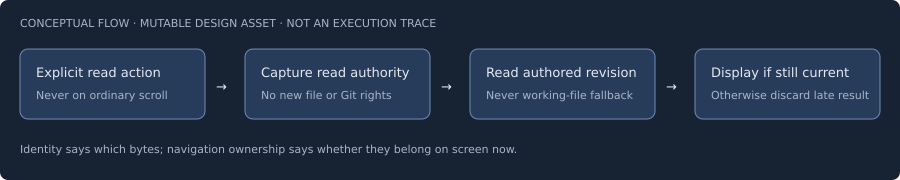

# Reviewing pinned evidence

> **Sample notebook — design specimen, not an active guided tour.** Only the
> existing source cards can be interactive today. Step order, prompts, review
> states and feedback below illustrate proposed behavior. Nothing records answers
> or sends agent requests. See the [interaction draft](../design.md).

## Review brief

**Question:** When a notebook shows code, are we reading the intended immutable
material, and can late responses confuse the reader?

**Scope:** Architecture/behavior at Pi Web commit
`76e5fe4d06cb18f0eb800210dc1aaa4ced36bb92` in the independently authorized physical
checkout `/home/robert/projects/3rdparty/pi-desk`. Local branch `main` is an
authorization reference, not the content selector. No feature-range comparison
or test execution is claimed by this sample.

**Audience:** A reviewer familiar with asynchronous UI requests but not these
notebook internals. Start with identity, compare request handling, then state
what the evidence does and does not establish.

## Chapters in authored order

| Chapter | Steps | Purpose |
| --- | --- | --- |
| [1. Evidence identity](01-evidence-identity.md) | 1.1–1.3 | Inspect, compare and judge |
| [2. Evidence limits](02-evidence-limits.md) | 2.1 | Separate source inspection from execution evidence |

Proposed notebook ID: `pinned-evidence-review`. Stable chapter, step and question
IDs are given in prose for discussion; this is not a manifest parser contract.
In the future reader, Start guided reading opens step 1.1. Step 1.3's Next opens
step 2.1 across the chapter file boundary. All chapters/steps remain selectable.

## Recording, later

The reader-only increment needs no review-data write. In the interactive
increment, Enable review recording shows the local sidecar destination before
requesting write access. [Review-data notes](review-data/README.md) distinguish
reviewer records from agent replies; this specimen creates neither.

**Reviewed never means approved, correct or tested.** Source cards identify
material; displayed test code is not a test result. External sources, if added,
remain explicit links rather than automatically loaded evidence.
